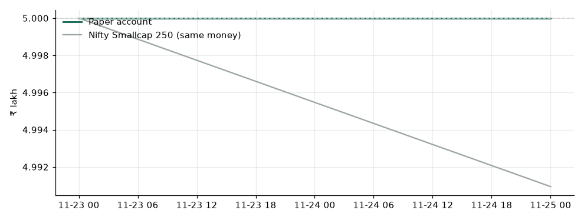

# Dividend run-up paper trading

**Dashboard: https://ajbhutada.github.io/dividend-paper-trader/**

_Updated after the close on 28 Nov 2026. Paper money only: no real orders are placed._

| | |
|---|---|
| Started | 2026-11-23 with ₹5,00,000 (paper money) |
| Equity now | ₹5,00,000 (+0.0%) |
| Closed trades | 0 |
| Yearly rate so far | shown after 3 months |
| Nifty Smallcap 250 since start | +0.9% |
| Open positions | 0 using ₹0 of margin |
| Per-share limit this quarter | ₹50,000 (2026Q4) |
| Backtest expectation | about +2.3% per trade on the position, about 60% winners |

## Open positions
_None yet._

## Dividends being watched (next 25 trading days)
_None yet._

## Closed trades (latest 30)
_None yet._

## Month by month
_None yet._

## Skipped dividends and why
_None yet._

## Rules in short
- NSE EQ shares of ₹500–8,000 cr (₹500–2,500 cr first; ₹2,500–8,000 cr only when 20% of the account stays free afterwards) with a dividend of at least 0.5% of the price, at least ₹20 lakh traded a day, no circuit locks, no bonus/split nearby.
- Buy on the later of 10 trading days before the ex-date and the first trading day after the record-date news, at the average of calm 1-minute candles (no volume spikes), in 5 orders.
- Sell at the close of the last cum day; 10% stop-loss below the buy price.
- All open positions together never more than 2x the account (MTF exposure cap).
- A stock that lost money in every year it was traded (3+ years) is not bought; its dividends are followed on paper and one profitable year lifts the block.
- Size: Rs 50,000 margin per share for the paper test (fixed; the past-data tests used 10% of capital at each quarter's start) (Kite, then Upstox, then Groww MTF; otherwise cash, 2x for dividends of 1.5% or more), never more than 10% of the day's traded value.
- Costs: per-order brokerage, STT, stamp duty, exchange and SEBI fees, GST, DP, pledge, MTF interest and an estimate of our own price impact.

**Live dashboard: https://ajbhutada.github.io/dividend-paper-trader/** (updated after every bot job). Example with a full year of past-data trades: https://ajbhutada.github.io/dividend-paper-trader/example-2026/. Research and paper trading only, not investment advice.
