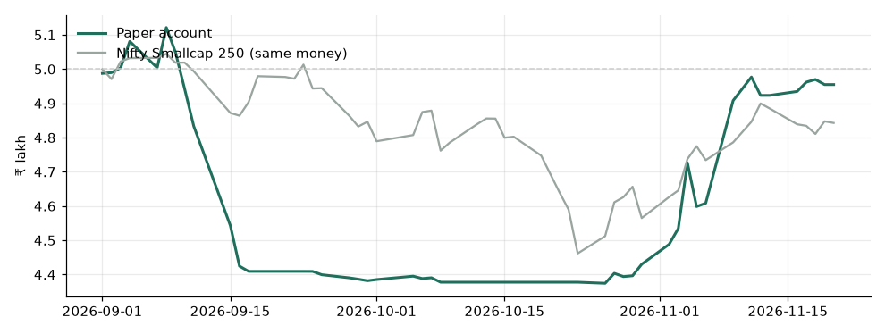

# Dividend run-up paper trading

> **Sample only:** a test run of the same rules on past data (1 Sep - 20 Nov 2026, paper money), to show what the dashboard looks like. The real paper trading starts on 23 Nov 2026 and is shown on the repository main page.

_Updated after the close on 20 Nov 2026. Paper money only: no real orders are placed._

| | |
|---|---|
| Started | 2026-09-01 with ₹5,00,000 (paper money) |
| Equity now | ₹4,95,493 (-0.9%) |
| Closed trades | 22, 9 winners (41%), average +0.17% per trade on the position |
| Yearly rate so far | shown after 3 months |
| Nifty Smallcap 250 since start | -3.1% |
| Open positions | 0 using ₹0 of margin |
| Per-share limit this quarter | ₹44,090 (2026Q4) |
| Backtest expectation | about +2.3% per trade on the position, about 60% winners |

## Open positions
_None yet._

## Dividends being watched (next 25 trading days)
_None yet._

## Closed trades (latest 30)
| Stock | Broker | Bought | Buy | Sold | Sell | Why | Profit (₹) | On margin % |
|---|---|---|---|---|---|---|---|---|
| BFINVEST | Kite MTF | 2026-11-16 | 467.53 | 2026-11-19 | 487.01 | last cum day close | 3165 | 7.18 |
| SOMANYCERA | Kite MTF | 2026-11-05 | 560.06 | 2026-11-12 | 541.53 | last cum day close | -5201 | -11.8 |
| IGPL | Upstox MTF | 2026-11-04 | 576.99 | 2026-11-12 | 581.41 | last cum day close | -191 | -0.43 |
| BMWVENTLTD | Groww MTF | 2026-11-04 | 64.42 | 2026-11-12 | 65.69 | last cum day close | 1031 | 2.34 |
| ORIENTTECH | Kite MTF | 2026-11-03 | 198.23 | 2026-11-12 | 214.5 | last cum day close | 8549 | 19.39 |
| REPCOHOME | Kite MTF | 2026-10-29 | 311.78 | 2026-11-12 | 389.36 | last cum day close | 31751 | 72.01 |
| GPTHEALTH | Kite MTF | 2026-11-06 | 144.24 | 2026-11-11 | 143.99 | last cum day close | -748 | -1.7 |
| INSECTICID | Kite MTF | 2026-10-28 | 516.28 | 2026-11-11 | 544.98 | last cum day close | 4089 | 9.28 |
| GPTINFRA | Kite MTF | 2026-11-05 | 111.19 | 2026-11-09 | 111.91 | last cum day close | -66 | -0.15 |
| GANESHCP | Kite MTF | 2026-10-26 | 158.45 | 2026-11-06 | 187.56 | last cum day close | 15379 | 34.88 |
| ACCELYA | Kite MTF | 2026-09-24 | 1121.01 | 2026-10-08 | 1093.85 | last cum day close | -3169 | -6.34 |
| HGS | Upstox MTF | 2026-09-03 | 396.12 | 2026-09-17 | 386.16 | last cum day close | -5168 | -10.34 |
| ARIHANTCAP | Kite MTF | 2026-09-03 | 78.69 | 2026-09-17 | 81.17 | last cum day close | 2241 | 4.48 |
| TNPL | Kite MTF | 2026-09-10 | 155.37 | 2026-09-16 | 152.01 | last cum day close | -4276 | -8.55 |
| TNPETRO | Kite MTF | 2026-09-02 | 134.03 | 2026-09-16 | 120.39 | 10% stop | -16411 | -32.82 |
| EXCELINDUS | Cash | 2026-09-02 | 1025.64 | 2026-09-16 | 966.32 | last cum day close | -3100 | -6.2 |
| AGARIND | Kite MTF | 2026-09-02 | 440.26 | 2026-09-16 | 409.4 | last cum day close | -7885 | -15.77 |
| AJMERA | Kite MTF | 2026-09-01 | 115.87 | 2026-09-15 | 114.31 | last cum day close | -3015 | -6.03 |
| BCLIND | Kite MTF | 2026-09-03 | 36.33 | 2026-09-15 | 32.63 | 10% stop | -16315 | -32.63 |
| PRAKASH | Kite MTF | 2026-09-01 | 126.63 | 2026-09-15 | 119.43 | last cum day close | -9581 | -19.16 |
| DENTA | Groww MTF | 2026-09-01 | 271.4 | 2026-09-15 | 276.16 | last cum day close | 946 | 1.89 |
| VENKEYS | Kite MTF | 2026-09-02 | 1656.89 | 2026-09-10 | 1705.85 | last cum day close | 3467 | 6.93 |

## Month by month
| Month | Trades | Wins | Profit |
|---|---|---|---|
| 2026-09 | 11 | 3 | -₹59,097 |
| 2026-10 | 1 | 0 | -₹3,169 |
| 2026-11 | 10 | 6 | ₹57,758 |

## Skipped dividends and why
| Stock | Ex-date | Dividend % | Mcap (₹ cr) | Why skipped |
|---|---|---|---|---|
| FUSIONCX | 2026-11-27 | 0.26 |  | market cap outside 500-2,500 cr; dividend < 0.5% |
| PASHUPATI | 2026-11-23 | 0.02 | 247.0 | market cap outside 500-2,500 cr; dividend < 0.5%; bonus/split/rights nearby |
| VRAJ | 2026-11-25 | 0.5 | 398.0 | market cap outside 500-2,500 cr; dividend < 0.5%; too little trading |

## Rules in short
- NSE EQ shares of ₹500–2,500 cr with a dividend of at least 0.5% of the price, at least ₹20 lakh traded a day, no circuit locks, no bonus/split nearby.
- Buy on the later of 10 trading days before the ex-date and the first trading day after the record-date news, at the average of calm 1-minute candles (no volume spikes), in 5 orders.
- Sell at the close of the last cum day; 10% stop-loss below the buy price.
- Size: 10% of capital at the start of each quarter as margin per share (Kite, then Upstox, then Groww MTF; otherwise cash, 2x for dividends of 1.5% or more), never more than 10% of the day's traded value.
- Costs: per-order brokerage, STT, stamp duty, exchange and SEBI fees, GST, DP, pledge, MTF interest and an estimate of our own price impact.

Interactive version: download `dashboard.html` from this repo and open it in a browser. Research and paper trading only, not investment advice.
